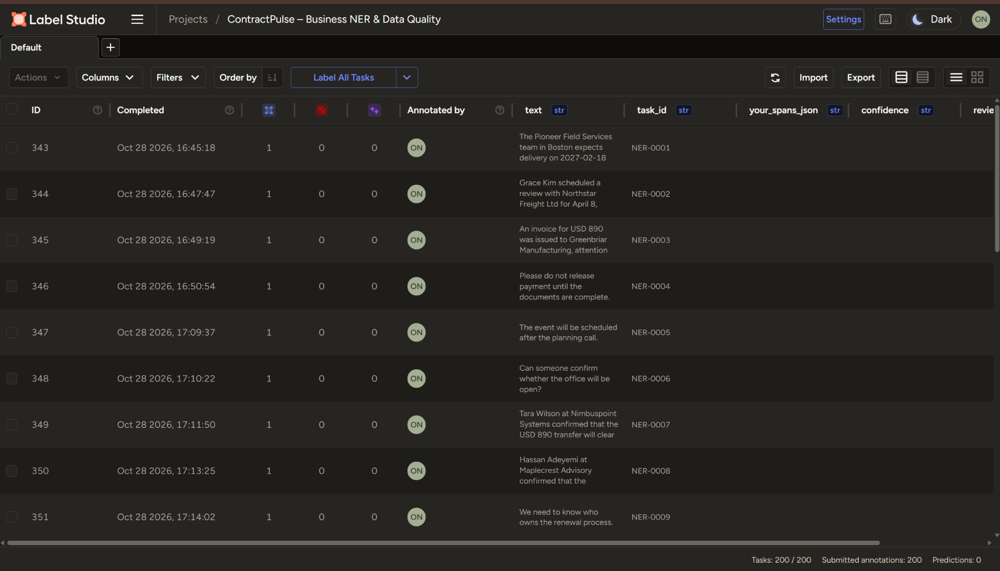
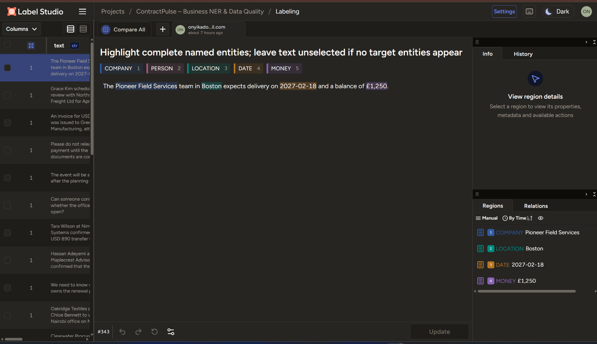
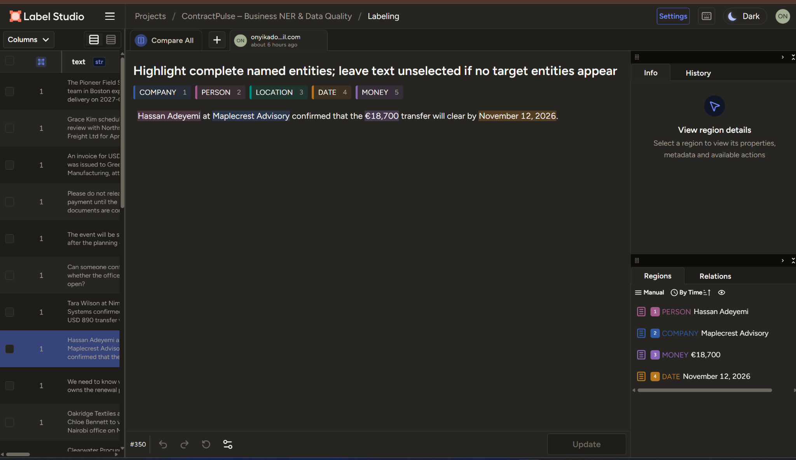
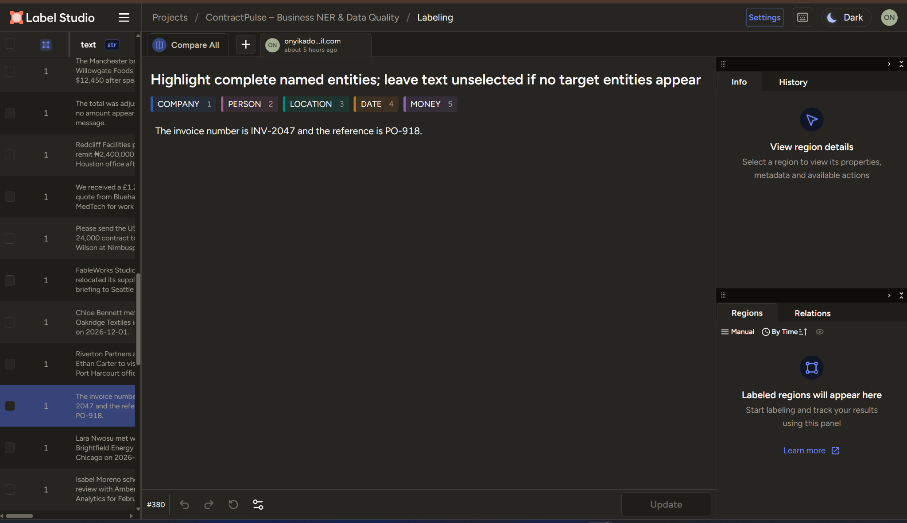
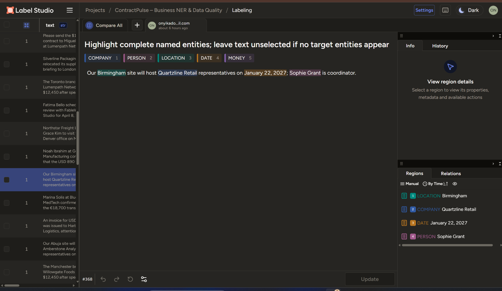
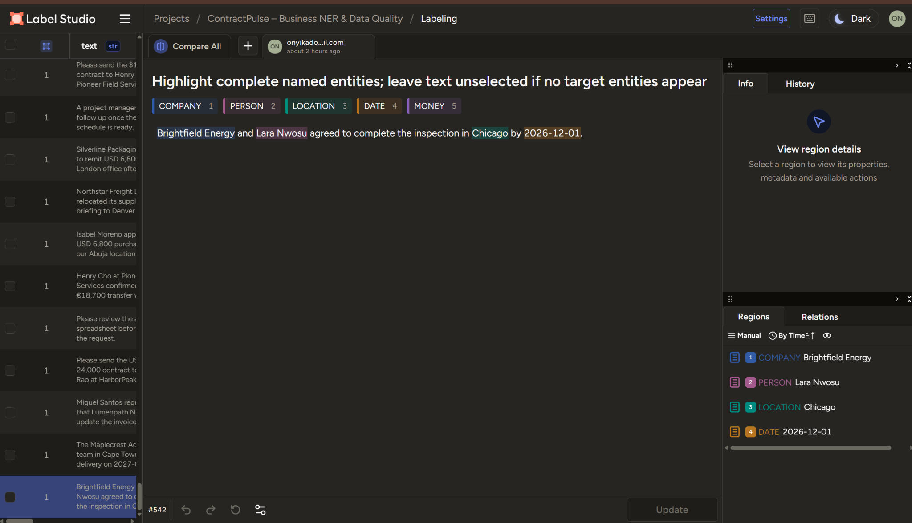

# ContractPulse
### Turning unstructured procurement communications into reliable, structured business records

**Named Entity Recognition · Data Annotation · Procurement Operations · Data Quality Assurance**

> **The business problem:** Procurement teams receive vendor quotes, contract instructions, payment updates, inspection schedules, and location references in free-form messages. Important operational details can be scattered across sentences, making records difficult to standardize, search, and review. **ContractPulse demonstrates a quality-controlled extraction workflow** that identifies the details needed to organize those communications.

**Project type:** Independently created, synthetic business-operations portfolio case study  
**Tools:** Label Studio Community Edition · CSV · manual NER annotation · rule-based data-quality checks  
**Scope:** 200 messages · 5 entity categories · 650 labeled entities · 20 deliberately entity-free messages  
**Status:** Dataset annotated; exported annotations normalized and structurally validated

---

## At a glance

| Metric | Verified result |
|---|---:|
| Business communications reviewed | **200** |
| Completed Label Studio tasks | **200 / 200** |
| Entity spans extracted | **650** |
| Positive annotation tasks | **180** |
| No-target-entity tasks | **20** |
| Entity classes | **5** |
| Whitespace-boundary issues fixed in final export | **52** |
| Unexpected leading/trailing whitespace after normalization | **0** |
| Source messages or entity labels altered during final normalization | **0** |



**Why this matters:** The result is not just color-coded text. It is a traceable extraction dataset that can be used as a prototype for structured vendor records, payment-reference review, deadline indexing, and procurement search workflows.

## The operational challenge

Consider a typical vendor communication:

> *Grace Kim scheduled a review with Northstar Freight Ltd for April 8, 2027; the budget is ₦2,400,000.*

To track this accurately, an operations team may need to identify **who**, **which supplier**, **when**, and **how much**. Free-form communications do not reliably separate those fields. Manual re-entry is time-consuming and vulnerable to inconsistent spelling, omitted entities, and accidental mixing of reference IDs with monetary figures.

**ContractPulse's approach:** define a business-focused entity taxonomy → annotate text spans → audit completeness, entity boundaries, and labels → normalize the structured export → prepare row-level records for downstream review.

This portfolio project **demonstrates the extraction and preparation workflow**. It does not claim to be a deployed procurement application or to have measured time savings in a live organization.

## From message to structured record

| Source detail | Target field | Example |
|---|---|---|
| Vendor or organization name | `COMPANY` | Northstar Freight Ltd |
| Named individual | `PERSON` | Grace Kim |
| Geographic place | `LOCATION` | Port Harcourt |
| Explicit calendar date | `DATE` | April 8, 2027 |
| Amount with currency | `MONEY` | ₦2,400,000 |

**Annotation policy:** highlight the full named entity, include legal suffixes (`Ltd`) and currency symbols/codes (`₦`, `€`, `USD`), and exclude surrounding spaces and unrelated punctuation. Generic nouns such as *office*, *branch*, and *team* are not included in geographic or company spans unless part of an actual name. See [the full labeling guide](docs/annotation_guidelines.md).

### Evidence 1 — Contextual entity extraction

The sample below shows distinct entities in a single procurement communication, including a multiword company name, deadline, and financial amount.



### Evidence 2 — Vendor, named contact, payment and date



### Evidence 3 — A valid record with no target entities

Invoice identifiers and PO numbers are **not** automatically MONEY or DATE entities. ContractPulse explicitly retains messages with **zero** matching entity types rather than inventing labels.



## Dataset coverage

| Entity category | Annotations |
|---|---:|
| COMPANY | 160 |
| PERSON | 140 |
| LOCATION | 120 |
| DATE | 110 |
| MONEY | 120 |
| **Total** | **650** |

**Task difficulty mix:** 110 messages with four entities; 70 messages with three entities; 20 messages with no target entities. Dates include ISO and natural-language formats; monetary values include USD as a code and `$`, `£`, `€`, and `₦` symbols. Locations include single-word and multiword place names.

## Quality assurance — where the real work happens

A colored highlight may look correct in Label Studio yet include an invisible extra space in the stored annotation. Since downstream systems use **character offsets**, this is a genuine data-quality problem.

The original final-session export contained **52 trailing-space annotation issues** (51 `LOCATION`, one `MONEY`). The normalization step removed those spaces and corrected the corresponding `end` offsets **without editing the messages, categories, task IDs, or other export fields**.

The QA process verifies:

- Every task has a unique ID and its original source message is unchanged.
- Stored entity text exactly matches `source_message[start:end]` (zero-based, end-exclusive).
- Every entity has exactly one of the five permitted labels.
- Annotated spans are non-empty, inside text boundaries, and nonoverlapping.
- No entity starts or ends with whitespace.
- Per-task entity counts match the provided reference-count file.
- All 20 intentional no-target tasks remain empty.
- No source or non-annotation metadata fields were changed during normalization.

**Measured results are structural QA, not gold-standard accuracy.** A single-annotator workflow without an independent adjudicated reference does not establish precision, recall, F1, or inter-annotator agreement. The full findings, change-control details, and limitations appear in the [QA report](docs/quality_assurance_report.md).

### Evidence 4 — Complete organization names and tight boundaries



### Evidence 5 — Multiple dimensions in the same message



## Business-ready data deliverables

| File | Purpose |
|---|---|
| [`data/contractpulse_labelstudio_cleaned.csv`](data/contractpulse_labelstudio_cleaned.csv) | **Primary deliverable.** Original Label Studio export schema, with only the 52 whitespace spans and their offsets normalized |
| [`data/contractpulse_entities.csv`](data/contractpulse_entities.csv) | One extracted entity per row, with source task, entity text, category, start/end offsets, and source sentence |
| [`data/contractpulse_structured_records.csv`](data/contractpulse_structured_records.csv) | One message per row; separate company/person/location/date/money columns, number of entities, and no-target indicator |
| [`docs/qa_correction_log.csv`](docs/qa_correction_log.csv) | Audit trail of every changed span, original/corrected character offsets, and the unchanged source sentence |
| [`docs/github_publication.md`](docs/github_publication.md) | Suggested repository name, SEO topics, and publishing checklist |
| [`docs/quality_assurance_report.md`](docs/quality_assurance_report.md) | Scope, checks, findings, constraints and release criteria |
| [`docs/annotation_guidelines.md`](docs/annotation_guidelines.md) | Reproducible entity definitions and edge-case decisions |
| [`docs/data_dictionary.md`](docs/data_dictionary.md) | Data fields, types, interpretation, and import notes |

**Downstream applications this dataset could support**, with additional engineering and evaluation: vendor-directory extraction, contract renewal/date indexing, quotation tracking, payable-review queues, and structured procurement records. No integration with actual ERP, accounting, or contract-management systems is claimed.

## Repository layout

```text
ContractPulse-GitHub-Portfolio/
├── README.md
├── data/
│   ├── contractpulse_labelstudio_cleaned.csv
│   ├── contractpulse_entities.csv
│   └── contractpulse_structured_records.csv
├── docs/
│   ├── annotation_guidelines.md
│   ├── business_use_case.md
│   ├── data_dictionary.md
│   ├── quality_assurance_report.md
│   ├── github_publication.md
│   ├── qa_correction_log.csv
│   └── screenshot_selection_guide.md
├── evidence/screenshots/
│   └── ... selected original Label Studio screenshots
└── scripts/
    ├── validate_dataset.py
    └── normalize_labelstudio_export.py
```

## How to review the work

1. Start with the [structured records](data/contractpulse_structured_records.csv) to see the business-useful output.
2. Open the [entity register](data/contractpulse_entities.csv) to inspect how each record maps to its original source and exact character offsets.
3. Review the [Label Studio export](data/contractpulse_labelstudio_cleaned.csv) to see the preserved annotation structure.
4. Read the [QA report](docs/quality_assurance_report.md) and [correction log](docs/qa_correction_log.csv) for the evidence behind the normalization.
5. Explore the screenshots in [`evidence/screenshots/`](evidence/screenshots/) for annotation decisions and intentional negative cases.

Optional, for reproducible verification with Python 3 (standard library only):

```bash
python scripts/validate_dataset.py
```

No programming is required to inspect the delivered CSV files in Excel or Google Sheets.

## Limitations and responsible representation

- **Synthetic data:** company names, people, and procurement messages are fictional for the purpose of this case study. Any resemblance to actual organizations is coincidental.
- **Not a production model:** this is human NER annotation and export QA, not a trained or deployed extraction service.
- **No measured business ROI:** benefits are potential use cases, not verified organizational savings.
- **Single annotator:** structural checks and provided reference entity counts are not a substitute for an independent expert review or measured prediction metrics.
- **Constrained text variety:** most examples are short and templated; live communications introduce document structure, ambiguous names, misspellings, and incomplete context.

### Bottom line

**ContractPulse demonstrates a practical data-operations capability: turning messy, unstructured business messages into clearly defined, traceable entity records while finding and correcting annotation defects.**

Built as a demonstrable portfolio case study for **AI Data Operations · Text Annotation · Data Quality · Procurement & Vendor Operations**.
